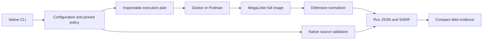

# Egolint Architecture

## Purpose and scope

Egolint uses a layered, contract-driven architecture. This document owns structural boundaries,
dependency direction, integration rules, and current-to-target evolution. Logical responsibilities
remain canonical in [SYSTEM.md](SYSTEM.md).

## Layer model

1. **Intent and contracts** — identity, policy, specifications, schemas, and accepted decisions.
2. **Domain** — canonical concepts and pure domain behavior.
3. **Application** — planning, orchestration, use cases, and state transitions.
4. **Adapters** — filesystems, providers, frameworks, renderers, and external tools.
5. **Interfaces** — CLI, library, site, reports, generated artifacts, and automation contracts.
6. **Evidence** — tests, diagnostics, provenance, manifests, and health projections.

Dependencies point inward toward stable contracts and domain behavior. External details do not
become canonical domain truth.

## Structural view

`src/main.rs`, `src/config.rs`, `src/plan.rs`, `src/rules`, `src/megalinter.rs` and `src/report.rs`
own this implemented source path. `src/contracts.rs` supplies shared typed contracts; generated
`schemas` expose their machine shape. [SYSTEM.md](SYSTEM.md) owns logical responsibilities, and
[the detailed architecture](docs/architecture.md) records execution limits.

## Dependency rules

- Sibling domain capabilities integrate through versioned public contracts, not direct access to
  internals.
- Generated artifacts never become the canonical source unless an accepted decision explicitly
  changes ownership.
- Provider and platform adapters depend on application ports; core behavior does not depend on a
  provider implementation.
- Read, plan, apply, verify, publish, and recover remain separate authority boundaries when
  consequential.
- Cross-repository references use releases, immutable commits, schemas, packages, or documented APIs
  rather than mutable default-branch assumptions.

## Ecosystem interfaces

- Hygiene policy
- Empathy baseline
- Relay workflows
- Pace conformance
- Observatory reporting

## Deployment and portability

The architecture favors independently usable local and self-hosted operation. Optional managed
services may add availability, collaboration, support, and hosted infrastructure without becoming
the canonical holder of portable state.

The lightweight CLI image and lint engine are separate products. The CLI image does not provide a
Docker daemon or promise host Git availability. The full engine inherits MegaLinter's entrypoint; an
in-image native CLI-to-engine adapter remains future work. The reviewed product-platform contract
selects CLI `linux/amd64,linux/arm64` and full engine `linux/amd64` only.

## Evidence and uncertainty

- **Observed:** Native policy, engine orchestration, normalized evidence and isolated fixes exist in
  source. Their package/fixture checks are distinct from release and consumer acceptance.
- **Current candidate:** The manual release adapter retains repository-owned signing, attestations,
  supported-platform smoke and immutable promotion stages behind the protected release environment.
- **Review base:** [PR #112](https://github.com/egohygiene/egolint/pull/112) adds adaptive
  selection, adoption modes and an advisory structural host adapter. This stacked candidate changes
  release orchestration and source guidance above that review base in
  [PR #113](https://github.com/egohygiene/egolint/pull/113). M1 under
  [roadmap #42](https://github.com/egohygiene/egolint/issues/42) owns local qualification and the
  milestone review; source readiness remains separate from release acceptance.
- **Deferred:** Signed publication and pinned fleet adoption remain under #5. Full-engine ARM64
  remains separate #45 work; source-build portability does not expand the promised product matrix.
